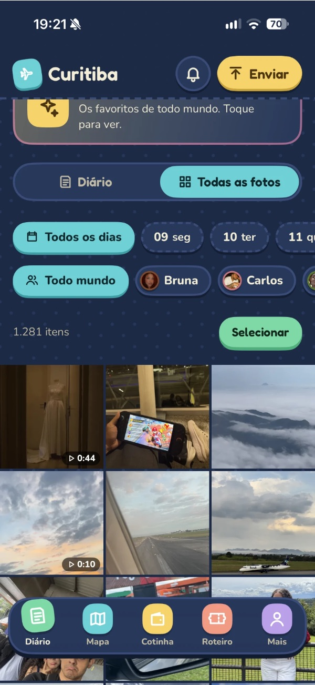
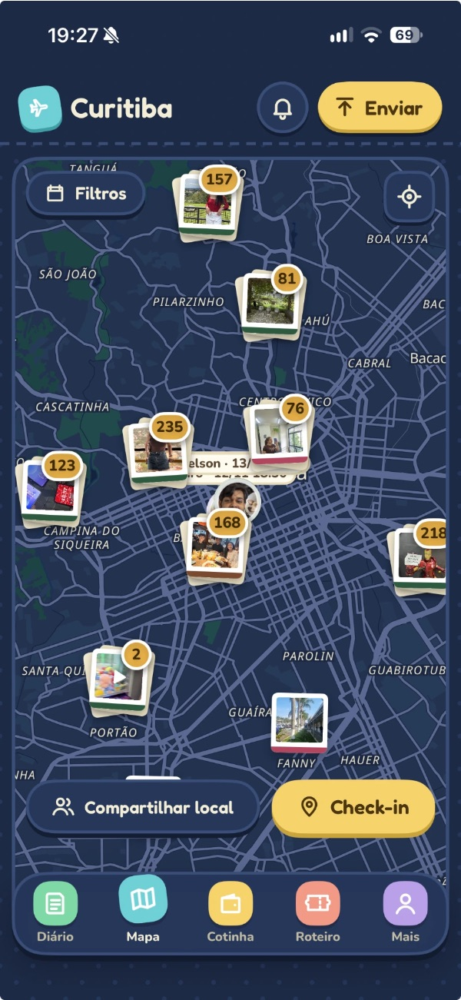
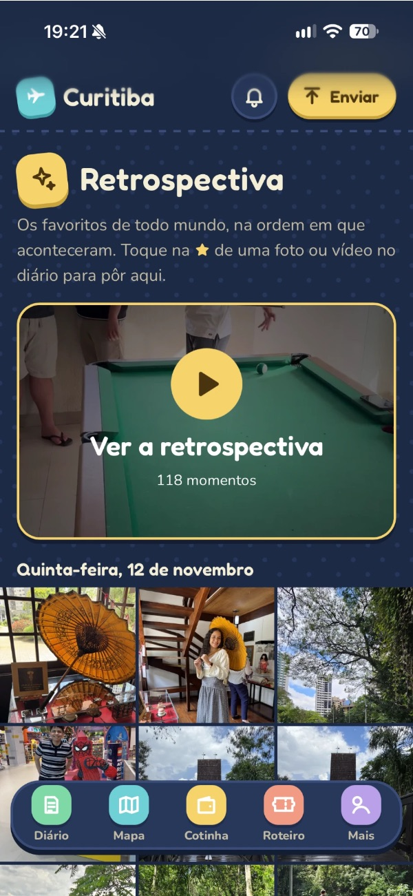
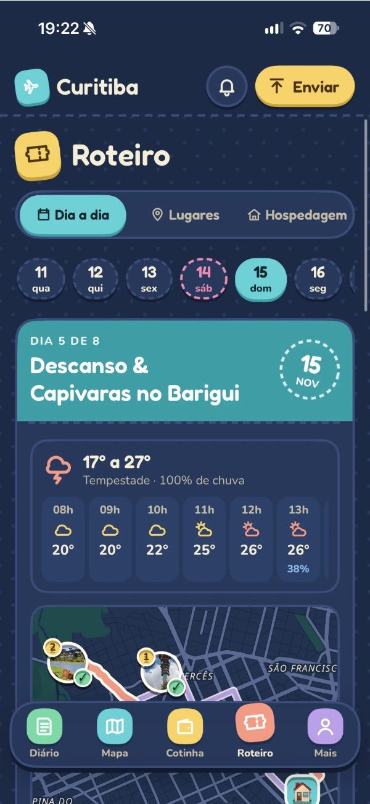
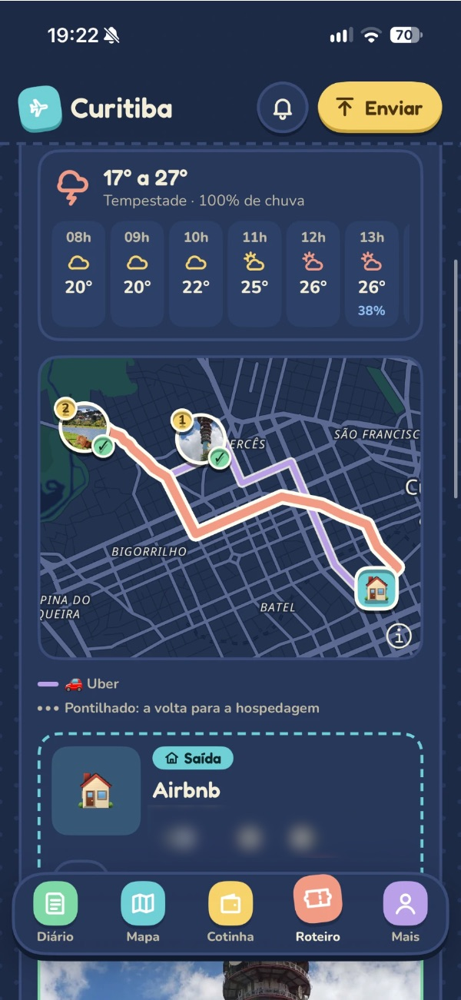
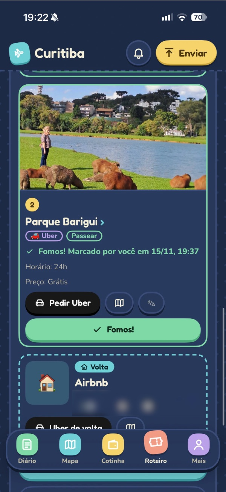
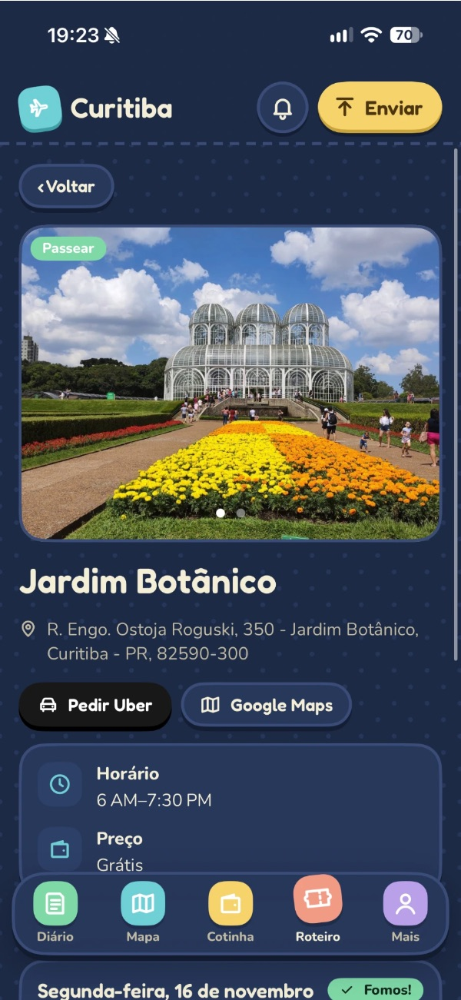
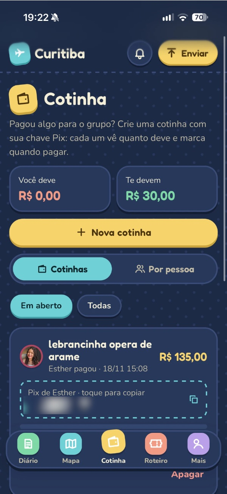
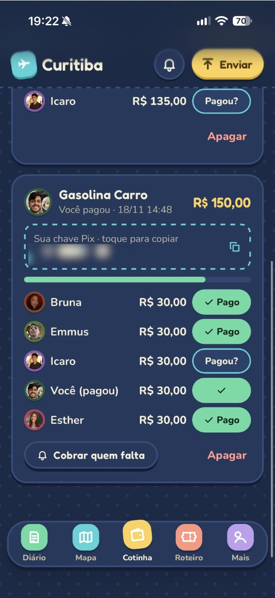

# Curitiba Trip ✈️🏝️

**One shared diary for a group trip.** A group of friends spent a week in Curitiba (11–18 November 2026) for a wedding. Instead of photos scattered across a dozen phones and WhatsApp groups, everyone sent theirs here: full-quality photos and videos, placed on a map and a timeline, with likes, comments, the day-by-day itinerary and the shared expenses in the same place.

It runs as a mobile-first website at **https://viagem.nelsul.com** (only people on the list can sign in) and as native apps for iPhone and Android, all with the same cozy "island" look. The interface is in Portuguese (pt-BR); the code, comments and docs are in English.

<table>
  <tr>
    <td></td>
    <td></td>
    <td></td>
  </tr>
  <tr>
    <td align="center"><b>Diário</b><br>Every photo and video, by day and by person</td>
    <td align="center"><b>Mapa</b><br>Photos as polaroids where they were taken</td>
    <td align="center"><b>Retrospectiva</b><br>Everyone's favorites, played as stories</td>
  </tr>
  <tr>
    <td></td>
    <td></td>
    <td></td>
  </tr>
  <tr>
    <td align="center"><b>Roteiro</b><br>Each day's plan, with hourly weather</td>
    <td align="center"><b>Route</b><br>Where we went, in order, and the way back</td>
    <td align="center"><b>Stops</b><br>Call an Uber, open the map, tick "Fomos!"</td>
  </tr>
  <tr>
    <td></td>
    <td></td>
    <td></td>
  </tr>
  <tr>
    <td align="center"><b>Places</b><br>Photos, hours, prices and directions</td>
    <td align="center"><b>Cotinha</b><br>Split a purchase, pay by Pix</td>
    <td align="center"><b>Who paid</b><br>Everyone ticks their share</td>
  </tr>
</table>

<sub>Screenshots from the iPhone during the trip. Pix keys and the lodging address are blurred.</sub>

## What it does

- **Diário.** A feed newest first, one photo or video per post, under wooden day signs. Filter by day or by person, or switch to **Todas as fotos**, a grid of everything. Tap any photo for full-screen reels you swipe up, with pinch to zoom. Like, comment with **@menções**, and star favorites.
- **Enviar.** Send photos and videos at their original quality. Each keeps its own date and location from the file. Uploads keep going with the app closed, and "Só no Wi‑Fi" sends a light preview right away and the original later.
- **Mapa.** Every photo as a polaroid where it was taken, grouped as you zoom out. Check in at a place with a map picture, and optionally share your live location with the group.
- **Roteiro.** The plan for each day, with the route on a map, the weather hour by hour and a page per place (photos, hours, prices, an Uber button). Admins edit it; anyone ticks "Fomos!" once the group has been there. Each person's day starts and ends at their own hotel or Airbnb.
- **Cotinha.** Someone paid for the group? Create a split with your Pix key; everyone sees what they owe, copies the key and marks it paid. Reminders go to whoever is late.
- **Retrospectiva.** Before the wedding, a countdown. Afterwards, everyone's favorites in the order they happened, played like stories, opening on the most starred moment.
- **Keep and share.** Pick photos to download the originals all at once (a ZIP on the web, straight into the phone's gallery in the apps), or join up to 9 of them into a framed image for Instagram or WhatsApp.
- **Visitors** (web). Anyone in the group can make a code that lets someone outside the trip read the Diário for 2 hours, without the map, the itinerary, the money or any way to post.
- **Little touches.** A notifications page, a special effect when the bride or groom like your post, and reminders to check in when you arrive somewhere.

### Everything in all three

| | Website | iPhone | Android |
|---|---|---|---|
| Sign in: pick your name, get a 6-digit code by email | ✔ | ✔ | ✔ |
| Diário, Todas as fotos, reels, likes, comments, favorites | ✔ | ✔ | ✔ |
| Download several originals at once | ZIP | Fotos | galeria |
| Enviar in full quality, Wi‑Fi-only mode | ✔ (shows previews) | ✔ (in the background) | ✔ (in the background) |
| Mapa, check-ins, live location | ✔ | ✔ (also with the app closed, if turned on) | ✔ (also with the app closed, if turned on) |
| Roteiro, weather, place pages, "Fomos!" | ✔ | ✔ | ✔ |
| Cotinha with Pix | ✔ | ✔ | ✔ |
| Retrospectiva | ✔ | ✔ | ✔ |
| Notifications | bell | bell + phone notifications | bell + phone notifications |
| Visitor codes | ✔ | — | — |
| Admin: manage people | `/admin` | opens the site | opens the site |

## How it's built

| Folder | What | Stack |
|---|---|---|
| [`web/`](web) | The website, the JSON API the apps use, and the media worker | SvelteKit 2 · Svelte 5 · TypeScript · PostgreSQL + Drizzle · Cloudflare R2 · MapLibre · pg-boss + ffmpeg / libvips / exiftool |
| [`ios/`](ios) | Native iPhone app, installed from a Mac (no App Store) | SwiftUI · iOS 17+ · XcodeGen · MapLibre Native · Nuke |
| [`android/`](android) | Native Android app, shared as a signed APK (no Play Store) | Kotlin · Jetpack Compose · Android 8+ · MapLibre Android · WorkManager · Coil |
| [`design/`](design) | The one source of the look: colors, fonts, icons, app icon | Node scripts that generate the web CSS, `Theme.swift` and `Tokens.kt` |

A few choices worth knowing:

- **Originals are never touched.** Phones upload straight to R2 in parts. A worker reads the date and place from the file and makes the smaller versions (photos with libvips, videos with ffmpeg), so the feed is quick and the original is always there to download.
- **The apps talk to the same API as the website.** It's documented in [`web/API.md`](web/API.md). The apps add what only a phone can do: uploads and location in the background, saving to the gallery, local notifications.
- **One look everywhere.** The design tokens in [`design/`](design) generate the styles for all three, so a color or icon changes in one place.
- **Cheap to run.** One small server with Docker, Postgres and the worker; files in Cloudflare R2; maps from OpenFreeMap. No push notification service, no app stores.

## Run it locally

You need Node 22.18+ and Docker.

```bash
cd web
cp .env.example .env      # local-only values, never commit .env
npm install
npm run dev:db            # local Postgres in Docker
npm run db:migrate
npm run dev               # http://localhost:5173
```

Then open **http://localhost:5173/dev-login**. It signs you in as a throwaway test user, works only in development, and returns 404 in production. More in [`web/README.md`](web/README.md).

The apps can run against this local server too: see [`ios/README.md`](ios/README.md) and [`android/README.md`](android/README.md).

## How changes ship

- `main` is protected: every change goes through a pull request.
- CI (`.github/workflows/ci.yml`) runs on every pull request:
  - `check` (required): the design tokens are up to date, then the web type check and build.
  - `android`: builds the Android debug APK.
- **Merging into `main` deploys the website and API automatically** (`deploy.yml`). Database migrations run when the app starts.
- The apps aren't deployed: the iPhone app is installed from a Mac with Xcode, and Android gets a new signed APK shared with the group.

## Docs

| | |
|---|---|
| [`CONTRIBUTING.md`](CONTRIBUTING.md) | Workflow, guidelines, secrets |
| [`web/README.md`](web/README.md) | How the website and worker fit together, local development, database changes, production |
| [`web/API.md`](web/API.md) | Every API endpoint the apps use |
| [`ios/README.md`](ios/README.md) · [`ios/PLAN.md`](ios/PLAN.md) | iPhone app: build, test, install; the original plan |
| [`android/README.md`](android/README.md) · [`android/PLAN.md`](android/PLAN.md) | Android app: build, test, release APK; the plan |

## Contributing

See [CONTRIBUTING.md](CONTRIBUTING.md). In short: branch, keep the cozy-island look, test on a phone-sized screen, open a pull request. **Never commit secrets.**
